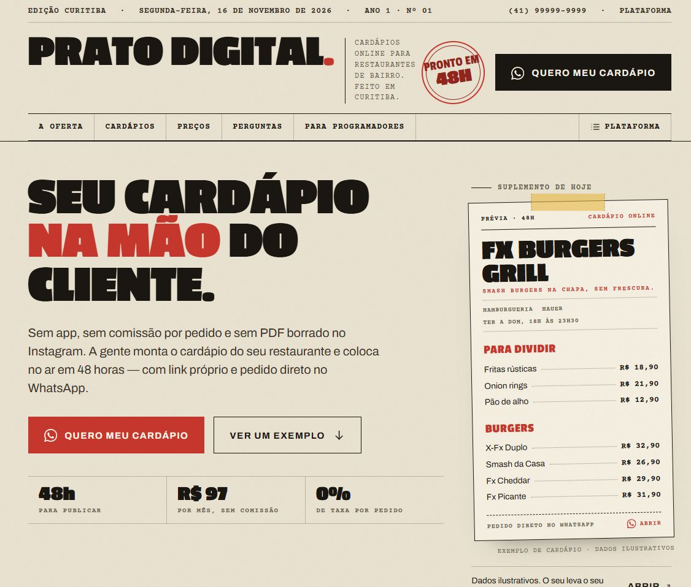
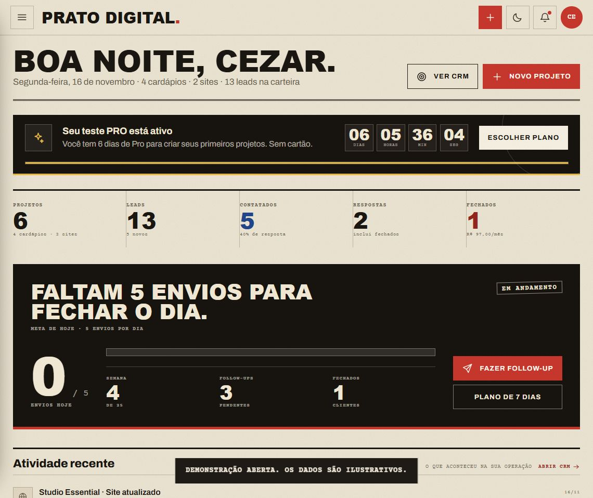
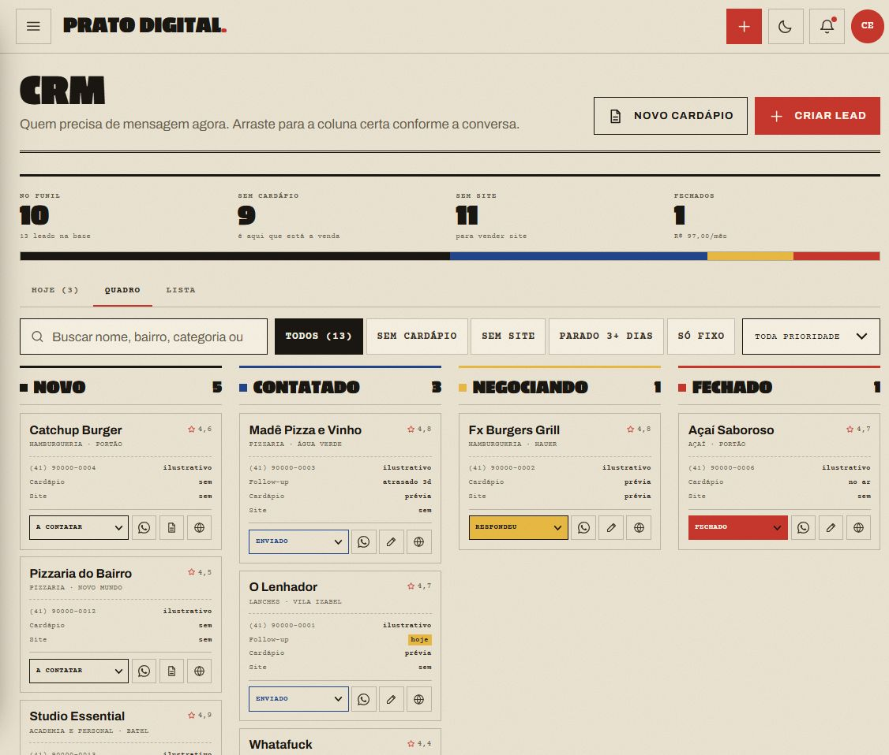
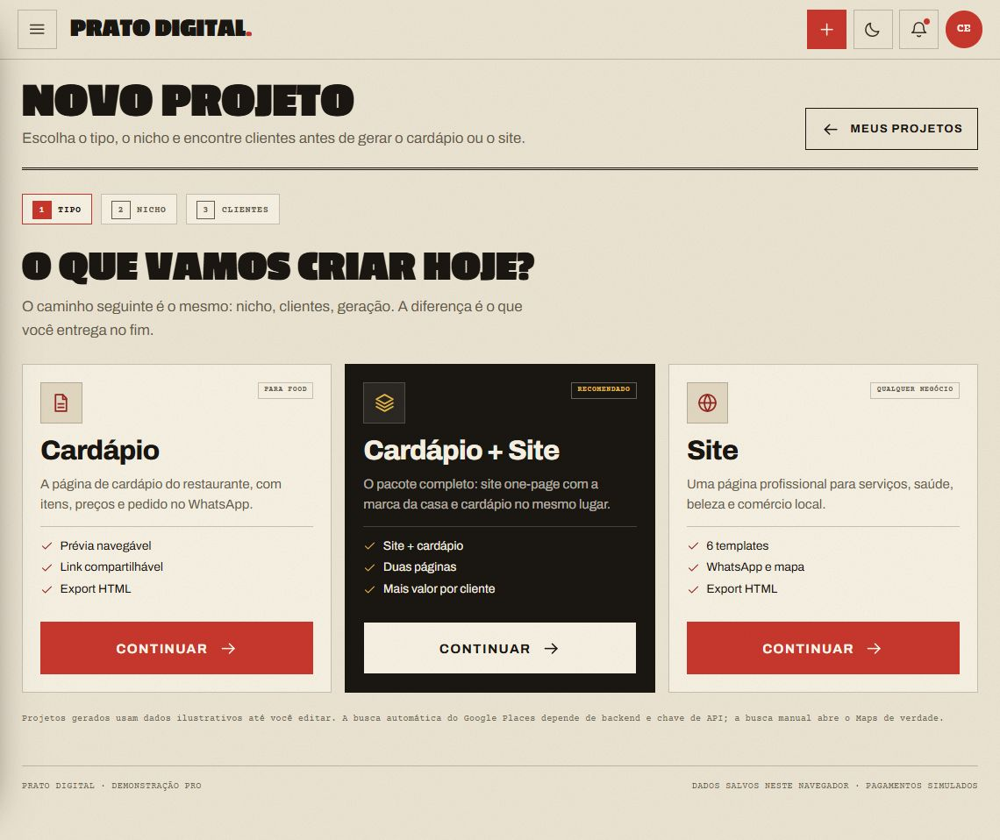

# Prato Digital — plataforma de cardápios para desenvolvedores

[](https://github.com/augusto10vellozo-coder/prato-digital/actions/workflows/ci.yml)

SaaS para desenvolvedores e agências venderem cardápios digitais a restaurantes. O assinante encontra/importa restaurantes, gera uma prévia navegável do cardápio, envia pelo WhatsApp e acompanha a venda no CRM. O restaurante paga o desenvolvedor; o desenvolvedor paga a assinatura da plataforma.

**[▶ Abrir a demonstração](https://augusto10vellozo-coder.github.io/prato-digital/demo/)** — entra direto na conta de demonstração, com dados ilustrativos e nada enviado a servidor.

   

> **Estado:** v2.4 funcional (demonstração). Auth simulada no navegador (contas, sessão e trial Pro de 7 dias), sem backend, cobrança real ou verificação de e-mail: assinatura, leads, cardápios, sites e feedback vivem no navegador, com export/import JSON, links com dados na URL e HTML autônomo.
>
> **Marca de trabalho:** “Prato Digital” e os contatos em `src/config.ts` são placeholders. Troque antes de publicar.

<table>
  <tr>
    <td align="center" valign="top"><br><sub><b>Landing</b> — oferta, prévia e preços</sub></td>
    <td align="center" valign="top"><br><sub><b>Dashboard</b> — funil, metas e atividade</sub></td>
  </tr>
  <tr>
    <td align="center" valign="top"><br><sub><b>CRM</b> — quadro por etapa com filtros</sub></td>
    <td align="center" valign="top"><br><sub><b>Wizard</b> — tipo, nicho e clientes</sub></td>
  </tr>
</table>

<sub>Capturas do app real rodando com a conta de demonstração. Dados ilustrativos.</sub>

## O que tem

**Site público**
- `/` — landing do restaurante: oferta, demonstração, calculadora de comissão, preços, FAQ e WhatsApp.
- `/parceiros` — landing para desenvolvedores: modelo de assinatura, calculadora de margem, planos e FAQ.
- `/c/:slug` — cardápio público mobile-first (também aceita `?m=<payload>` para abrir em qualquer navegador).
- `/bio` — prévia do link na bio do desenvolvedor.
- `/app/*` — plataforma logada.

**Conta (auth simulada no navegador)**
| Rota | Tela |
|---|---|
| `/criar-conta` | Cadastro em 2 passos: conta (nome, e-mail, senha) → operação (negócio, cidade, WhatsApp). Cria o trial Pro de 7 dias |
| `/entrar` | Login com e-mail e senha; devolve para a rota pedida |
| `/demo` | Abre a conta de demonstração com a carteira ilustrativa |

**Plataforma** (todas as rotas exigem sessão)
| Rota | Tela |
|---|---|
| `/app` | Dashboard: teste/plano, metas de envio, atividade, métricas, projetos recentes (cardápios e sites), funil e checklist |
| `/app/novo` | **Wizard de novo projeto:** tipo → nicho → clientes (89 cidades em 27 estados, busca ilustrativa/manual e mapa interativo) → criação em massa |
| `/app/projetos` | Meus projetos: cardápios e sites, filtros, copiar link, exportar HTML, editar |
| `/app/crm` | CRM: quadro (Novo → Contatado → Negociando → Fechado), visão Hoje e Lista, busca, filtros e drawer do lead |
| `/app/templates` | Templates de cardápio e de site por ramo |
| `/app/prospeccao` | Prospecção em massa: colar lista, pré-visualizar e criar leads (Pro) |
| `/app/planos` | Plano e créditos: trial, limites de projetos, troca de plano com checkout simulado |
| `/app/vendas` | Clientes fechados, MRR, setups e projeção |
| `/app/precificacao` | Calculadora de preço de criação/manutenção (Pro) |
| `/app/contratos` | Gerador de contrato simples, copiar/baixar (Pro) |
| `/app/area-de-membros` | Kit de scripts, checklist, proposta e precificação |
| `/app/primeiro-cliente` | Plano de 7 dias com progresso real da carteira |
| `/app/link-na-bio` | Editor e prévia da página de links (Pro) |
| `/app/afiliados` | Link de indicação e comissão (Agência) |
| `/app/feedback` | Feedback com nota e histórico |
| `/app/conta` | Perfil, plano, tema claro/escuro, backup/importação e limpeza |
| `/app/projetos/:leadId` | Editor do cardápio com prévia, temas, itens e exportação |
| `/app/sites/:leadId` | Editor do site one-page: identidade, destaques, serviços, tema e exportação |
| `/s/:slug` | Site público one-page (aceita `?d=<payload>` para abrir em qualquer navegador) |

## Planos (proposta de lançamento)

| Plano | Preço | Limite | Inclui |
|---|---|---|---|
| Starter | R$ 49/mês | 10 projetos (cardápios e sites) | CRM, templates, link/export |
| Pro | R$ 97/mês | 40 projetos (cardápios e sites) | + prospecção em massa, precificação, contratos, link na bio |
| Agência | R$ 197/mês | ilimitado | + afiliados, 5 usuários, white-label (em breve) |

- Teste **PRO de 7 dias** por padrão.
- Preços e limites em `src/lib/plans.ts`.
- **Checkout simulado:** nenhum cartão é cobrado e nenhum dado financeiro é coletado.
- Oferta ao restaurante (separada da assinatura): R$ 597 de criação + R$ 97/mês, em `src/config.ts`.
- **Wizard de novo projeto:** escolhe Cardápio, Site ou Cardápio + Site; nicho; cidade; busca ilustrativa de 10/20 negócios ou colagem manual; cria leads + projetos em lote.
- **Cobertura nacional:** 89 cidades nas 5 regiões (todas as capitais e as principais cidades de cada estado), com DDD, coordenadas e bairros por cidade. O seletor tem busca e filtro por região.
- **Mapa do wizard:** peça cartográfica própria (malha de ruas, quadras, parques, rio, rótulos de bairro, escala, coordenadas e bússola), com zoom, arrastar e pinos numerados que selecionam o negócio na lista. Continua rotulado como ilustrativo.
- A busca automática do Google Places **não** está conectada. A demo gera resultados ilustrativos; o botão “Google Maps” abre a busca real e a aba manual aceita a lista colada. O backend/API é o próximo passo.

## Rodar

```bash
npm install
npm run dev
```

Abre em `http://localhost:5173`. O app está em `/app`.

```bash
npm run build     # TypeScript + build de produção em dist/
npm run preview   # serve o build localmente
```

## Stack e arquitetura

- **Vite + React + TypeScript + React Router**, SPA estática (Vercel/Netlify).
- CSS próprio com tokens; sem Tailwind. `src/styles/base.css`, `site.css`, `menu.css`, `panel.css`, `app.css`.
- Estado em `src/lib/store.tsx` (Context + `localStorage`), seed em `src/lib/seed.ts`.
- App: `src/app/AppLayout.tsx` + `src/app/pages/*`.
- Regras de plano: `src/lib/plans.ts` + `src/lib/usePlan.ts` (limite = cardápios + sites).
- Métricas do funil/metas: `src/lib/appStats.ts`.
- Templates de cardápio: `src/lib/templates.ts`.
- Templates de site: `src/lib/siteTemplates.ts`.
- Nichos e busca ilustrativa: `src/lib/niches.ts`, `src/lib/demoBusinesses.ts`, `src/lib/brazilCities.ts`.
- Mapa do wizard: `src/components/CityMap.tsx`; seletor de cidade: `src/components/CityPicker.tsx`.
- Export HTML: `src/lib/menuExport.ts` e `src/lib/siteExport.ts` (fontes embutidas em base64).
- Links compartilháveis: `src/lib/share.ts` (JSON + base64 URL-safe em `?m=` para cardápio e `?d=` para site).

### Modelo de dados

`AppData` guarda `leads`, `menus`, `sites`, `subscription`, `settings` (tema + bio) e `feedback`.
`Lead` tem status (`a-contatar`, `enviado`, `respondeu`, `fechado`, `descartado`), prioridade, follow-up, histórico, `menuId`, `siteId` e `deal` (setup/mensal ao fechar).
`Menu` tem tema (`encarte`, `noite`, `leve`), cor da casa, categorias/itens e `isDemo`.
`Site` tem tema (`claro`, `escuro`, `areia`), destaques, serviços, `menuId` opcional e `isDemo`.
`Subscription` tem plano, status (`trial`, `active`, `expired`) e datas.

## O que trocar antes de publicar

| Onde | O que |
|---|---|
| `src/config.ts` | WhatsApp, e-mail, Instagram, horário, nome do operador, oferta ao restaurante |
| `src/lib/plans.ts` | Preços, limites, features e ordem dos planos |
| `src/lib/templates.ts` | Templates de cardápio (6 hoje) |
| `src/lib/siteTemplates.ts` | Templates de site (6 hoje) |
| `src/lib/niches.ts` | Nichos do wizard e links de busca no Maps |
| `src/lib/brazilCities.ts` | Cidades, UFs, regiões, DDD, coordenadas e bairros |
| `src/lib/demoBusinesses.ts` | Resultados ilustrativos da busca automática |
| `src/lib/seed.ts` | Leads e cardápios de exemplo (telefones fictícios) |
| `index.html`, `public/favicon.svg` | Título, descrição, favicon |
| `src/components/SiteFooter.tsx` | Aviso de demonstração do rodapé |
| Marca “Prato Digital” | Nome de trabalho; trocar exige revisar textos, e-mails e título |
| `public/robots.txt` | Bloqueia `/app` e `/painel`; revise se publicar o app com auth |

## Dados e privacidade

- Persistência: `localStorage`, chave `prato-digital:v1`.
- **Exportar/importar JSON** em `/app/conta`. “Limpar tudo” apaga leads, cardápios, assinatura e feedback do navegador.
- O seed usa nomes de restaurantes reais de Curitiba com **telefones fictícios**; é demonstração. Não suba uma carteira real em deploy aberto.
- O app tem **login simulado no navegador** (e-mail + senha com hash SHA-256 local). Isso separa contas e protege o fluxo, mas não é segurança real: em produção, use auth de servidor, verificação de e-mail e reset de senha. O `robots.txt` não é autenticação.
- O HTML exportado contém o telefone/WhatsApp do restaurante — é intencional, é o entregável ao cliente.

## Link compartilhável x HTML exportado

- **Cardápio:** `/c/slug?m=<dados>` carrega o cardápio inteiro na URL e abre em qualquer navegador, sem backend. URLs ficam longas (2–8 KB) — boa para prospecção, não ideal para produção.
- **Site:** `/s/slug?d=<dados>` faz o mesmo para o site one-page. O CTA de cardápio no site compartilhado aparece quando o cardápio também está no navegador do visitante; no HTML exportado e no link de WhatsApp, os dois links vão juntos.
- **HTML:** “Exportar HTML” gera um arquivo único com fontes embutidas, CSS, conteúdo completo e WhatsApp — para cardápio e para site. É o entregável robusto para hospedar no domínio do cliente.
- **Bio:** `/bio` é uma prévia local nesta v2.1; em produção precisa publicar o perfil e os links no servidor.

## Limitações da v2.1

- Sem backend, pagamento real, upload de fotos, Google Places, e-mail transacional ou múltiplos usuários. A auth é simulada no navegador (sem verificação de e-mail, reset de senha ou sessão de servidor).
- Assinatura e checkout são simulados; o estado fica no navegador.
- Limite de plano é aplicado na criação de novos projetos, mas trocar para um plano menor com mais projetos que o limite não apaga nem bloqueia os existentes (só impede novos).
- Cards de “abertura de cardápio/site” não são rastreados de verdade; a atividade do dashboard vem do histórico do CRM.
- White-label por parceiro está no roadmap; hoje o cardápio/site/HTML assina Prato Digital.
- A busca automática no Google Maps **não existe**: o wizard gera resultados ilustrativos, abre a busca real em nova aba e aceita importação manual. O Google Places precisa de backend + chave.
- O mapa do wizard é uma peça ilustrativa (não usa tiles do Google/OSM) e a base de 89 cidades é uma amostra das principais cidades de cada estado, não todos os municípios.
- O site compartilhado não carrega o cardápio junto; o link do cardápio vai separado na mensagem ou no HTML exportado.
- O seed é ilustrativo; nenhum depoimento, cliente ou métrica real é exibido.

## Verificações feitas

- `npm run build` sem erros de TypeScript.
- `npm test` — **27 testes em 6 suítes** (Vitest): formatação e telefone, importação de leads,
  links de WhatsApp, payload compartilhado, métricas do funil e exportação em HTML.
- Code-splitting por rota: a entrada caiu de 606 KB para **349,8 KB (110 KB gzip)** e cada página
  do app é carregada sob demanda.
- Lighthouse **100/100/100** (acessibilidade, boas práticas, SEO) em: landing, parceiros, dashboard, CRM, projetos, planos, templates, wizard, editor de site, `/bio`, `/s/studio-essential` e `/s/fx-burgers-site`.
- Fluxos testados: troca de tema, trial/upgrade simulado, gate de plano, wizard automático e manual (tipo → nicho → busca → seleção → criação em lote), templates → lead + cardápio/site, CRM (quadro/hoje/lista), drawer com site, link `?m=`/`?d=`, export HTML de cardápio e site, bio, contrato e precificação.
- Detector visual do Impeccable sem apontamentos.

## Deploy

Já inclui `vercel.json` (rewrites de SPA + cache de fontes) e `netlify.toml`. Rode `npm run build` e publique `dist/`. O rewrite é necessário para `/app`, `/app/crm`, `/c/:slug` etc. em recarregamento direto.

A demo pública também é publicada automaticamente no **GitHub Pages** pelo workflow
`.github/workflows/pages.yml`: o build usa a base `/prato-digital/`, gera `404.html` e uma entrada
`demo/index.html` para a rota `/demo/` abrir com status 200.

## Documentação

- [`CONTEXTO.md`](CONTEXTO.md) — produto, modelo de negócio, decisões, arquitetura e pendências.
- [`TAREFAS.md`](TAREFAS.md) — backlog priorizado e dívidas conhecidas.
- [`DESIGN.md`](DESIGN.md) — sistema visual do site e do app.
- [`PRODUCT.md`](PRODUCT.md) — registro de produto.
